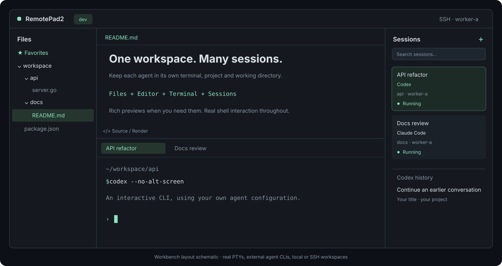
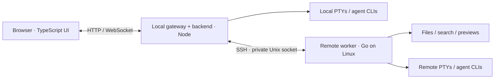

<div align="center">

# RemotePad2

**A browser workbench for your terminals and coding agents.**

Run several agent sessions in their own projects. Switch between real terminals, inspect files, and keep context together — locally or over SSH.

[](https://github.com/fkwai/remotePad2/actions/workflows/ci.yml)
[](https://github.com/fkwai/remotePad2/actions/workflows/nightly.yml)
[Development branch](https://github.com/fkwai/remotePad2/tree/dev) · [中文说明](docs/README.zh-CN.md) · [Workbench guide](docs/WORKBENCH_GUIDE.md)

</div>



RemotePad brings a Herdr-style multi-session workflow to the browser, with an editor, file explorer and rich previews beside your terminals. The interface above is a layout schematic.

## What you can do

- **Manage agent sessions.** Launch Shell, Codex, Claude Code or a custom CLI with a name, working directory and project label. Search, filter, rename and switch between sessions.
- **Keep agents in real terminals.** Use their existing interactive UI, authentication and approval flow. RemotePad owns the PTY; each agent owns its runtime and model configuration.
- **Work locally or over SSH.** Save remote machines, see connection state and reconnect. Linux targets use a prebuilt Go worker; other targets use the Node worker fallback.
- **Inspect the work.** Files, Favorites, Repos and nested search on the left; editable code, folder views and Markdown/HTML/image/data previews in the middle.
- **Continue Codex conversations.** Browse your titles and project labels. Resume unowned CLI histories or follow a conversation owned by the local Codex App.

## Quick start

Local requirements: **Node.js 22+** and **pnpm 10.15.0**. The default GitHub branch is `main`; use `dev` for current development features.

```sh
git clone --branch dev https://github.com/fkwai/remotePad2.git
cd remotePad2
pnpm install --frozen-lockfile
pnpm build
pnpm gateway
```

In a second terminal, start the development channel:

```sh
pnpm lanes start dev
```

Open **http://127.0.0.1:6020/dev/**. A running channel is left untouched by `start`.

For frontend development, `pnpm dev` serves Vite at **6021** with the local backend at **6020**. Use an isolated checkout/runtime for development; leave existing user sessions running.

## Your agent sessions

In the right **Sessions** panel, click **+** to choose an agent and working directory. Give sessions names such as “API refactor” and “Docs review”, then use search and agent/state filters to find them. Right-click a session or terminal tab for Rename / Close. The terminal icon starts a plain shell in the selected directory.

| Session source | Current support |
| --- | --- |
| Shell | Interactive login shell in the selected directory |
| Codex | New CLI sessions, existing history, custom titles/project labels, local App follower |
| Claude Code | Launch its interactive `claude` CLI in a managed terminal |
| Custom CLI | One executable with quoted arguments, e.g. another agent or an explicit shell |

Install and authenticate each agent on the machine where it will run. RemotePad uses your normal CLI configuration and permission prompts. Custom commands do not expand shell expressions; use an explicit shell if you need pipes or expansion.

**Running/Exited describe process liveness.** Agent-specific thinking, completion and approval states are a next step. Existing Claude conversations are not automatically indexed; Codex history is the currently integrated history source. Each workbench window manages the selected machine; an all-machines overview is future work.

## Local + remote architecture



`apps/web` owns the UI, `apps/server` the local backend/gateway, `apps/worker` the Linux Go worker, and `packages/protocol` the shared browser/API types. Node remains the fallback worker for other targets and App-owned remote conversations.

The Go worker is built in CI for **Linux amd64 and arm64** and delivered as a binary. Supported Linux targets need OpenSSH forwarding, a POSIX shell and tar; they do not need Go, Node or pnpm installed for the worker. Node fallback targets need Node.js 22+ with npm. See the [SSH reference](docs/WORKBENCH_GUIDE.md#ssh).

## Sessions and lifecycle

| Action | What happens |
| --- | --- |
| Refresh or close the browser | Backend-owned shells keep running; reopen them from Sessions |
| Hide a panel or switch tabs | Its sessions keep running |
| Close a managed terminal session | Its process ends |
| Detach a Codex App follower | The App conversation stays open |
| Disconnect SSH | Forwarding stops; the remote worker and its shells remain |
| Restart a backend | Sessions owned by that backend end; restart persistence is not provided |

The workbench binds to **loopback** and has **no account system**. Keep it private. Files and terminals run with the backend user's permissions.

## Channels

One gateway at **6020** serves `/main/`, `/dev/` and `/nightly/`. Use the small channel badge beside the wordmark to switch. The **RemotePad2** wordmark manages workspace windows and their machines.

- **dev:** active development. Agent-made changes may merge after CI passes.
- **nightly:** a validated dev snapshot published daily by GitHub Actions; failed checks keep the previous snapshot.
- **main:** stable release, promoted only on an explicit release request.

Publishing or pulling commits does not restart a running backend. [Channel and update details](docs/WORKBENCH_GUIDE.md#channels-and-one-local-entry).

## Development and checks

```sh
pnpm build
pnpm test
pnpm exec playwright install --with-deps chromium
pnpm test:e2e
pnpm test:gateway
```

The Go worker has its own checks:

```sh
cd apps/worker
go test -race ./...
```

CI also tests the Go worker through an isolated SSH fixture and builds both Linux architectures. Tests use isolated HOME/session state; configure `E2E_PORT` and `E2E_WORK_ROOT` together when running browser suites in parallel.

Read [AGENTS.md](AGENTS.md) for the product map and development rules. Development can run locally in an isolated worktree or on xtia; the earlier [xtia handoff](docs/XTIA_DEVELOPMENT.md) is retained as historical context.

## Next

- Provider adapters for reliable agent activity and approval status.
- More agent history sources and an overview across machines.
- Additional layouts built from the same Files / Sessions / Editor / Terminal components.
- Editor/debugger integration and simpler packaged local delivery.

RemotePad2 is under active development. The browser UI is TypeScript; its build tools and local backend use Node, and the Linux SSH worker is Go.
