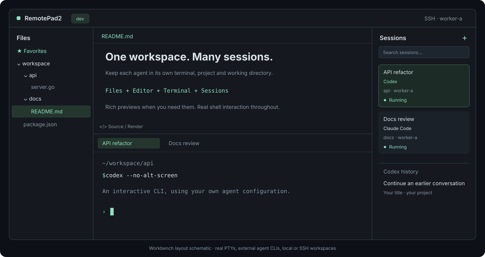

# RemotePad2

**在浏览器里管理终端和 coding agent session 的工作台。**

[English](../README.md) · [当前开发版](https://github.com/fkwai/remotePad2/tree/dev) · [详细操作说明](WORKBENCH_GUIDE.md)



目标是提供类似 Herdr 的多 session 工作方式，同时用网页承载文件树、编辑器和丰富预览。上图是布局示意图。

## 现在可以做什么

- 在右侧 Sessions 创建 Shell、Codex、Claude Code 或自定义 CLI session，为它指定名称、工作目录和项目标签。
- 搜索、按 agent / 进程状态筛选、切换、重命名及关闭 session；各 session 在各自真实终端里独立运行。
- 浏览现有 Codex 历史，沿用你的标题和项目；已有 Codex App 拥有的本机对话通过 follower 同步。
- SSH 连接远程机器，保存常用目标，查看连接状态并断开/重连。
- 在左侧浏览文件、Favorites、Repos 和搜索；中间上方编辑/渲染，下方使用终端。四个面板可以调整大小和显隐。

Agent CLI 需要在目标机器安装并登录，RemotePad 使用它原本的交互、认证、模型配置和审批流程。

**Running / Exited 目前表示进程是否存活。** “正在思考 / 等待审批 / 已完成”等状态需要后续 provider adapter；Claude 历史目前不会自动索引。每个工作台对应所选机器，跨机器总览是后续能力。

## 启动

本机需要 Node.js 22+ 和 pnpm 10.15.0。最新功能在 dev，main 是稳定版。

```sh
git clone --branch dev https://github.com/fkwai/remotePad2.git
cd remotePad2
pnpm install --frozen-lockfile
pnpm build
pnpm gateway
```

另开终端：

```sh
pnpm lanes start dev
```

打开 **http://127.0.0.1:6020/dev/**。

右侧 **+** 新建 agent session；终端图标新建普通 shell；右键 session 或终端 tab 可以重命名和关闭。自定义 CLI 支持带引号的参数，若需要管道等 shell 语法，请显式运行 shell。

## 架构与生命周期

浏览器前端用 TypeScript，Node 负责前端构建和本机后端/gateway；Linux amd64/arm64 的远端 worker 已使用 CI 预编译的 Go 程序，其他目标保留 Node fallback。Go worker 不需要目标机安装 Go、Node 或 pnpm。

- 关闭网页、刷新、隐藏面板：shell 保留。
- 关闭对应终端 session：结束该进程。
- Disconnect SSH：断转发，远端 worker 和 shell 保留。
- Detach Codex App：不结束 App 对话。
- 重启持有 PTY 的后端：对应 shell 会结束；暂不支持后端重启后恢复进程。

程序绑定 loopback，没有账号系统；保持私有访问。默认 6020 入口下以 `/main/`、`/dev/`、`/nightly/` 分版本，切版本不会自动重启既有实例。

## 开发

先读 [AGENTS.md](../AGENTS.md)。当前用户已授权本地独立 worktree 继续开发，xtia 也可用于测试；不为了开发重启正在使用的程序。

构建/测试：`pnpm build`、`pnpm test`、`pnpm test:e2e`、`pnpm test:gateway`；Go worker 在 `apps/worker` 运行 `go test -race ./...`。CI 会额外验证 Go worker 的 SSH 接入和 Linux 两种架构。

下一步重点：可靠的 agent 活动/审批状态、更多历史源、跨机器总览、更多布局以及编辑器/debugger 协作。
